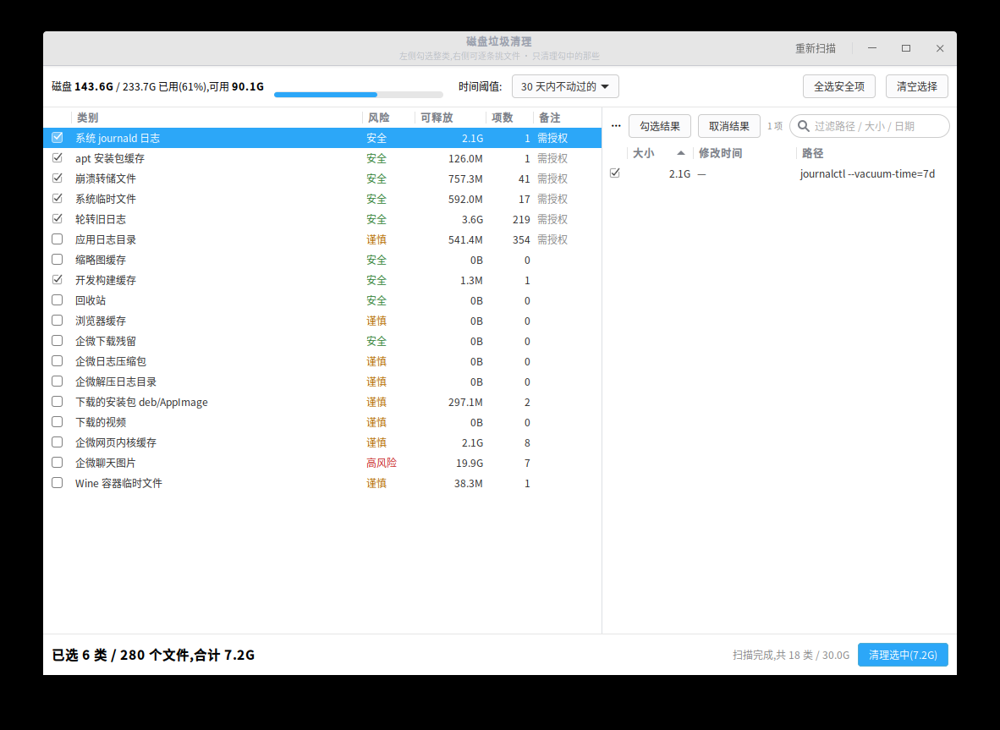

# diskc · UOS 磁盘垃圾清理

给 deepin / UOS 桌面用的磁盘垃圾清理工具。启动器里点开就能用:左边一遍类别和占用,勾选要清的,点某一行还能看到里面到底是哪些文件、双击直接在文件管理器里定位。

清理对象覆盖企业微信下载的日志与解压目录、deb 安装包、录屏视频、各类缓存和系统日志。



## 特性

- **三级风险分级**:安全 / 谨慎 / 高风险,默认只勾安全项,谨慎项自己挑,20G 的聊天图片不会被误删
- **先看再删**:每个类别都能展开看到具体文件(大小、修改时间、完整路径),双击在文件管理器中打开并选中
- **精确到文件**:左侧勾选 = 整类全选,右侧还能逐条取消或补勾,左侧自动变成半选;清理时只删真正勾中的那些文件,不是整类一起删
- **筛完再挑**:先按路径 / 大小 / 日期过滤,再点「勾选结果」/「取消结果」批量处理当前筛出来的那些
- **明细实时过滤**:右侧输入框即时筛选,`Ctrl+F` 聚焦、`Esc` 清空;过滤只影响列表显示,不改动任何勾选
- **时间阈值**:30 / 60 / 90 / 180 天 / 不限,最近动过的东西不会被扫进来
- **企业微信专项**:未完成的下载残留(`*.P2P.DOWNLOAD`)、日志压缩包(`log.tar.gz`、`var.zip`)、解压出来的 `var/log` 目录、deb 包、视频、网页内核缓存、聊天图片
- **系统类目自动提权**:journald、apt 缓存、coredump、`/var/tmp`、轮转日志标记「需密码」,勾选后在终端里输一次密码即可
- **图形界面 + 命令行**:同一个扫描核心,两个前端

## 安装

**方式一:deb 安装包(推荐)**

双击 `disk-cleaner_<版本>_all.deb` 即可,或者:

```bash
sudo dpkg -i disk-cleaner_1.2.0_all.deb
```

装到 `/usr/bin` 和 `/usr/share`,启动器里出现「磁盘垃圾清理」。卸载:`sudo apt remove disk-cleaner`。

**方式二:源码装到家目录(不需要 root)**

```bash
git clone git@github.com:shao-jun/disk-cleaner.git
cd disk-cleaner
./install.sh
```

装完后:

- 启动器搜索「磁盘垃圾清理」
- 或终端执行 `diskc`

卸载:`./uninstall.sh`

依赖:Python 3(GTK 界面需要 `python3-gi`,UOS/deepin 自带)。

## 管理员权限:什么时候要密码

只有这五类系统垃圾需要 root:journald 日志、apt 缓存、崩溃转储、`/var/tmp`、`/var/log` 轮转日志。企业微信、下载目录、浏览器缓存、回收站这些都不需要密码,直接删。

需要的时候**不会弹终端**,而是弹系统自己的认证框(和装软件、改系统设置时那个密码框一样),上面写着「清理系统日志与缓存需要管理员权限,请输入当前用户密码」,输的是当前用户的登录密码:

- **输对**:系统文件被删,窗口里直接告诉你删了几个、回收多少
- **点取消或输错**:退出码 126,系统文件一个都不动;普通文件不受影响(它们此时已经删完了)
- **刚输过密码**:短时间内再清理不会再问第二次

这个框来自 `pkexec` + 系统的 polkit 服务,动作定义在 `/usr/share/polkit-1/actions/org.diskcleaner.policy`(deb 包自带)。

所以推荐用 deb 安装:源码方式装到 `~/.local` 时程序不在 `/usr/bin`,认不到上面那条 polkit 规则,认证框会退化成系统默认文案(功能一样,只是提示写着「认证以运行 python3」)。只有系统里连 `pkexec` 都没有时,才会退回开终端执行 `sudo`。

## 打包与分发

```bash
./build.sh            # 输出到 dist/
./build.sh 1.3.0      # 指定版本号
```

| 产物 | 适合谁 | 怎么用 |
|---|---|---|
| `dist/disk-cleaner_<版本>_all.deb` | UOS / deepin 桌面用户 | 双击安装,或 `sudo dpkg -i` |
| `dist/disk-cleaner-<版本>.tar.gz` | 要拷源码、离线环境 | 解压后 `./install.sh` |

deb 是纯 Python,`Architecture: all`,amd64 / arm64 / loongarch 通吃,依赖只有 `python3`、`python3-gi`、`gir1.2-gtk-3.0`(UOS 自带)。

## 命令行用法

```bash
diskc                    # 交互式:扫描 → 编号勾选 → 回车清理
diskc -n                 # 只扫描列清单,不动任何文件
diskc -y -s              # 无人值守清理全部「安全」级
diskc --keys wx-temp,deb -y -d 60   # 按类别清理,60 天阈值
diskc -l                 # 列出所有类别
diskc --files-from a.json   # 按清单精确删除,GUI 提权清理走这条路
```

清单是 JSON 数组,每项 `["路径", 字节数]`,例如 `[["/var/log/syslog.1.gz", 1024]]`,只删清单里列出的文件。

交互模式下:`1 3` 切换类别,`a` 全选安全项,`n` 清空,`d3` 看第 3 项明细,回车执行。

## 清理类别

| 类别 | 风险 | 说明 |
|---|---|---|
| 系统 journald 日志 | 安全 | 按保留天数裁剪 systemd 日志 |
| apt 安装包缓存 | 安全 | `/var/cache/apt/archives` |
| 崩溃转储文件 | 安全 | `/var/crash`、coredump |
| 系统临时文件 | 安全 | `/var/tmp` 中 7 天前的 |
| 轮转旧日志 | 安全 | `/var/log` 下 `*.gz`、`*.1` |
| 缩略图缓存 | 安全 | 自动重建 |
| 开发构建缓存 | 安全 | npm/pip/node-gyp/electron/uv/go 等 |
| 回收站 | 安全 | |
| 企微下载残留 | 安全 | 没下完的碎片、Temp 目录 |
| 应用日志目录 | 谨慎 | `/var/log` 下 uos、udcp-client、wpslog 等 |
| 浏览器缓存 | 谨慎 | 登录态不受影响,网页首次打开变慢 |
| 企微日志压缩包 | 谨慎 | log/var 日志包 |
| 企微解压日志目录 | 谨慎 | 解压出的 `var/log`、`varlog` |
| 下载的安装包 deb/AppImage | 谨慎 | |
| 下载的视频 | 谨慎 | 录屏、企微视频 |
| 企微网页内核缓存 | 谨慎 | qtCef 缓存 |
| 企微聊天图片 | 高风险 | 删后历史图片需重新下载 |
| Wine 容器临时文件 | 谨慎 | deepinwine 里的 Temp/Cache |

## 注意

- 删除不进回收站,不可恢复。清理前建议退出企业微信,避免文件占用。
- 「下载的视频」可能包含工作录屏证据,默认不勾选,清理前请确认。
- 系统类目需要管理员权限,清理时弹系统认证框输一次密码,不开终端;取消则系统文件不动。

## 原理

扫描器按类别返回 `[(路径, 字节数)]`,统一交给删除逻辑。系统类目在没有 root 时也能统计出大小(`stat` 不需要读权限),只是标记为仅预览。

## 许可

MIT
